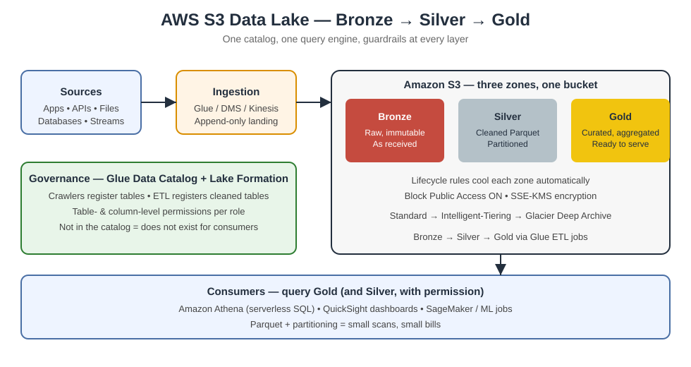

# AWS S3 Data Lake — Build a Lakehouse That Stays Cheap, Queryable, and Governed


> **TL;DR:** One S3 bucket is not a data lake — it is a junk drawer. A real data
> lake is three zones (Bronze → Silver → Gold), one catalog (Glue), one query
> engine (Athena), and one set of guardrails (Lake Formation + lifecycle rules)
> that stop storage costs and access sprawl before they start. This guide builds
> exactly that, with Terraform you can actually run.

## Why this matters

Most "data lakes" fail for the same three reasons:

1. **No zones** — raw dumps, cleaned tables, and dashboards all live in one
   prefix, so nobody trusts anything.
2. **No catalog** — every analyst re-discovers (or re-invents) the schema.
3. **No lifecycle** — hot data cools, nobody moves it, and the bill grows
   silently every month.

Fix those three and the lake mostly runs itself.

## Architecture



| Layer | S3 prefix | Format | Who writes | Who reads |
|-------|-----------|--------|------------|-----------|
| Bronze (raw) | `s3://<bucket>/bronze/` | Original files, immutable | Ingestion jobs only | Data engineers |
| Silver (cleaned) | `s3://<bucket>/silver/` | Parquet, partitioned | Glue ETL jobs | Engineers + analysts |
| Gold (curated) | `s3://<bucket>/gold/` | Parquet, aggregated | Approved pipelines only | Analysts, BI, ML |

## Bronze → Silver → Gold, in plain language

Think of it like a kitchen:

- **Bronze** is the grocery delivery — bags untouched, exactly as they arrived.
  If a recipe goes wrong, you can always start over from here.
- **Silver** is the prepped ingredients — washed, chopped, labelled. This is
  where most work happens.
- **Gold** is the finished dish — ready to serve, portioned for a specific
  audience (a dashboard, a report, a model).

Never serve straight from the grocery bags. Never re-prep what is already
prepped.

## Zone rules

| Rule | Bronze | Silver | Gold |
|------|--------|--------|------|
| Overwrite allowed? | No — append only, immutable | Yes, via job reruns | Yes, via approved jobs |
| Partitioning | By source + arrival date | By business date + key | By reporting grain |
| File format | As received (CSV, JSON, …) | Parquet + Snappy | Parquet + Snappy |
| Retention | Long (cheap tiers) | Medium | As business needs |
| PII allowed? | Yes, encrypted | Masked / tokenised | Only if the use case allows it |

## The catalog is the contract

AWS Glue Data Catalog is the single source of truth for "what tables exist,
what columns they have, and who may query them":

- A Glue **Crawler** discovers Bronze files and registers tables automatically.
- A Glue **ETL job** transforms Bronze → Silver and registers the result.
- **Lake Formation** grants table- and column-level permissions — analysts see
  only the columns their role is allowed to see, no bucket-policy gymnastics.

If a table is not in the catalog, it does not exist for consumers. Full stop.

## Storage tiers that actually save money

| Tier | When to use it | Relative cost |
|------|---------------|---------------|
| S3 Standard | Data queried in the last 30 days | Baseline |
| S3 Intelligent-Tiering | Access patterns unknown or shifting | Auto-optimised |
| S3 Standard-IA | Accessed a few times a quarter | ~45% cheaper |
| S3 Glacier Instant Retrieval | Rarely accessed, needs millisecond reads | ~68% cheaper |
| S3 Glacier Deep Archive | Compliance / "just in case" retention | ~95% cheaper |

The Terraform in this repo wires a lifecycle rule per zone: Bronze cools after
90 days, Silver after 60, and nothing sits in Standard forever by accident.

## Querying with Athena (no servers, pay per scan)

```sql
-- How many orders per day last week? (Silver zone, partitioned by dt)
SELECT dt, COUNT(*) AS orders, SUM(amount) AS revenue
FROM silver.orders
WHERE dt BETWEEN DATE '2026-10-19' AND DATE '2026-10-25'
GROUP BY dt
ORDER BY dt;
```

Three habits that keep Athena bills small:

1. **Store Parquet, not CSV** — columnar reads scan only the columns you ask for.
2. **Partition by date** — a `WHERE dt = ...` filter skips whole folders.
3. **Compress with Snappy** — smaller files, faster scans, same data.

A CSV table scanned in full costs roughly **10×** a partitioned Parquet table
for the same question. Format choice *is* cost control.

## Security checklist

- [ ] S3 Block Public Access ON (all four settings) on every zone bucket.
- [ ] Default encryption with SSE-KMS; separate KMS keys per sensitivity level.
- [ ] Lake Formation permissions — never grant `s3:*` to analyst roles.
- [ ] CloudTrail data events on Gold writes (who published what, when).
- [ ] No credentials in ETL code — IAM roles for Glue jobs, Secrets Manager
      for source-system passwords.

## Cost traps (learned the hard way)

| Trap | What happens | Fix |
|------|--------------|-----|
| Unpartitioned Athena queries | Every query scans the whole table | Partition + Parquet |
| Small files | Thousands of tiny objects, slow + pricey Glue runs | Compact / bucket files in ETL |
| No lifecycle rules | Standard-tier bill grows forever | Lifecycle per zone (included here) |
| Cross-region reads | Egress charges on every query | Keep lake, catalog, and consumers in one region |

## What's in this repo

| File | What it is |
|------|-----------|
| `README.md` | This guide |
| `architecture.svg` | Zone + catalog + query architecture |
| `s3-data-lake/main.tf` | Terraform: bucket, zones, lifecycle, Glue, Athena, Lake Formation basics |
| `quiz.md` | 5 questions to check you actually got it |

## Try it

```bash
cd s3-data-lake
terraform init
terraform plan   # read it before you apply — check region, bucket name, costs
terraform apply
```

> ⚠️ **Cost note:** S3, Glue, and Athena are mostly pay-per-use, but crawlers
> and ETL jobs are not free. Run the smallest dataset you can, check the
> pricing page for your region, and set a billing alarm before you scale up.

## Quiz teaser

Why should Bronze be immutable? (Answer in `quiz.md` — no peeking.)
